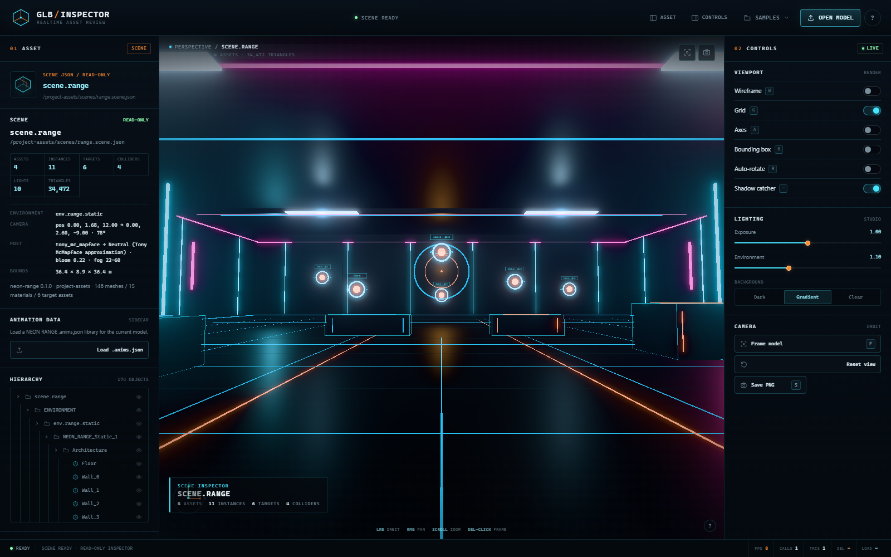

# GLB Inspector

A standalone, zero-build review tool for glTF assets **and** the NEON RANGE asset pack. It runs the original single-model viewer plus two read-only inspector modes:

- **Viewer** — drop a GLB/glTF, inspect geometry/materials/hierarchy, play clips, capture a clean viewport PNG.
- **Scene inspector** — `?scene=` composes `manifest.json` + `scene.json` into the arena: static shell, cover props, target drones, lights, camera, fog, bloom, colliders, spawn and target markers.
- **Coarse UI preview** — `?ui=` renders `theme.json` + `layout.json` + `strings.en.json` as DOM/CSS HUD, menu and results screens at 1600×900, 2400×1350 and 900px wide.

Everything renders locally with a vendored copy of three.js. There is no bundler, framework, CDN, upload or install step. **Wave 1 is read-only:** there are no TransformControls, no scene edits and no write endpoints.

**Live demo:** <https://hypnoes.github.io/glb-viewer/> — the viewer runs from the checked-in samples. The scene and UI inspectors also work there, but only with page-relative query parameters (for example `?scene=samples/neon/scenes/range.scene.json&manifest=samples/neon/manifest.json`), because the `/project-assets/` route exists only while `serve.py` is running locally.



## Run it

From a terminal, in the repository folder:

```powershell
cd glb-viewer
python serve.py
```

Any Python 3.9+ works; there is nothing to install.

Open **<http://127.0.0.1:8123/>**. To use another port (for example when 8123 is already occupied):

```powershell
python serve.py 8126
```

The server is stdlib-only, binds to `127.0.0.1`, disables caching, and serves the correct MIME types for `.glb`, `.gltf`, `.bin`, `.json`, `.mjs`, images, fonts and `.wasm`. Opening `index.html` via `file://` will not work because ES module imports and model fetches require HTTP.

### Project assets route

`serve.py` exposes the sibling NEON RANGE checkout **read-only**:

```text
../fps-demo/assets   ->   /project-assets/
```

The default path is resolved relative to the viewer checkout. Override it when the game checkout lives elsewhere:

```powershell
python serve.py 8126 --assets <path-to-fps-demo>\assets
# or
$env:NEON_PROJECT_ASSETS = '<path-to-fps-demo>\assets'
python serve.py 8126
```

Route guarantees:

- `GET` and `HEAD` only. `POST`/`PUT`/`PATCH`/`DELETE` return **405** with `Allow: GET, HEAD`.
- Requests are checked against loopback peers in addition to the `127.0.0.1` bind.
- `..` segments, null bytes and paths resolving outside the asset root return 404.
- Only asset-like extensions are served (`.json`, `.glb`, `.gltf`, `.bin`, images, fonts, `.ktx2`, `.hdr`, `.txt`, `.md`); other extensions return 415.
- Directory listings are not exposed for `/project-assets/`.
- `GET /api/project-assets` returns a small discovery document (`available`, `root` — a checkout-relative label, `manifest`, `scene`, `uiLayout`, `scenes`). It is what the scene test uses to prefer the real pack.

Direct URLs:

```text
http://127.0.0.1:8126/?model=samples/DamagedHelmet.glb
http://127.0.0.1:8126/?model=samples/neon/range_arena.glb
```

## Scene inspector (`?scene=`)

```text
http://127.0.0.1:8126/?scene=/project-assets/scenes/range.scene.json&manifest=/project-assets/manifest.json
```

Open the fixture without the game checkout:

```text
http://127.0.0.1:8126/?scene=/samples/neon/scenes/range.scene.json&manifest=/samples/neon/manifest.json
```

### Query parameters

| Parameter | Required | Meaning |
| --- | --- | --- |
| `scene` | yes | Scene JSON URL, absolute (`/project-assets/...`) or page-relative. |
| `manifest` | optional | Manifest URL. When omitted, the loader tries `scene.manifest`, then `<scene-dir>/manifest.json`, then `<scene-dir>/../manifest.json`. |
| `asset_base` / `assetBase` | optional | Override the base URL used for relative asset paths. |
| `targets=0` | optional | Skip instantiating target drones; render slot markers only. |
| `bloom=0` | optional | Disable the bloom composer for a raw-light comparison. Any finite number overrides the authored bloom value. |
| `model` | optional (viewer) | Model URL to open on boot. |
| `anims` | optional (viewer) | Sidecar `.anims.json` URL loaded together with `model`. |

### What gets composed

- `environment.static_model` is spawned as one GLTF scene.
- Every `props[].asset` is spawned as a separate GLTF scene with `transform.translation`, `rotation_y` / `rotation` and `scale`.
- Every `target_slots[]` entry with an `asset` spawns that asset (the real pack points at `prp.drone.mk2`) at the slot position, in rest pose. A cyan ring + label remains as the slot marker. Target hover bob/roll is runtime animation and is not recreated.
- `target_slots`, `spawn` (`spawn.position` / `spawn.rotation_y`) and collider AABBs are visualised: cyan rings with slot labels, a green spawn ring and cyan wireframe boxes.
- `environment.camera` applies position, target, fov, near and far. **Reset view** restores that authored camera; **Frame model** fits the whole scene.
- `environment.lights` supports `ambient`, `hemisphere`, `directional`, `point` and `spot`, including a point light with `"attach": "camera"` (parented to the preview camera using its local position).
- `environment.camera.post` applies the authored fog and clear colour, an approximate tone mapping and an approximate bloom pass.
- The left panel reports environment asset, asset count, instance count (environment + props + target drones), target-slot count, collider count, light count, triangle count, camera, post settings and world bounds. The hierarchy and material panels are live for the composed scene. The scene HUD repeats the instance/target counts over the viewport.

### Asset path resolution

Asset paths are resolved **relative to the manifest URL's directory** by default:

```text
/project-assets/manifest.json + models/props/prp_cover_crate.glb
  -> /project-assets/models/props/prp_cover_crate.glb
```

`asset_base` (in the manifest) or `?asset_base=` replaces that base. Page-absolute paths (`/...`), full `http(s)://` URLs and `data:` URLs pass through unchanged. The manifest itself accepts either `assets: [{ id, path, ... }]` or an `assets` object keyed by asset ID.

### Preview lighting and post-processing are approximations

Bevy luminances are not three.js candela, and the original renderer uses Tony McMapface + Bevy bloom. The inspector keeps the **authored** values in state/report but renders calibrated preview values:

| Scene data | Preview mapping |
| --- | --- |
| `ambient.brightness` | `three intensity = brightness / 1000` |
| `directional.illuminance` | `intensity = illuminance / 18000` |
| `point.intensity` (lumens) | `intensity = lumens / 80000`, `range` → distance, `decay` preserved |
| point with `attach: "camera"` | same but `/ 400000`, parented to the camera |
| `post.fog` | linear `THREE.Fog(color, start, end)` |
| `post.tonemapping` | `tony_mc_mapface` → `NeutralToneMapping` (closest built-in, documented approximation); ACES/AgX/Neutral/Reinhard/Cineon/Linear/None also map |
| `post.bloom` | authored value kept as `state.post.bloom`; rendered as a subtle `UnrealBloomPass` (`strength = bloom × 0.23`, threshold 0.85, radius 0.35) |
| studio environment | reduced to intensity `0.05` in scene mode; authored lights dominate |

Scene shadows, Bevy's exact exposure/tonemapper, skybox/reflection probes and per-material shader quirks are **not** reproduced. `test/scene-smoke-report.json` records both the authored and mapped light intensities.

The pack currently ships one cyan `prp.cover.crate`; the orange variant is a documented asset-pack gap.

### Automation API

```js
window.__GLB_VIEWER__.getState().mode;   // 'viewer' | 'scene' | 'ui'
window.__GLB_VIEWER__.getState().scene;  // full scene summary, null in viewer mode
window.__GLB_VIEWER__.loadNeonAnimations('/samples/neon/drone_mk2.anims.json');
window.__GLB_VIEWER__.selectAnimationClip(2);
window.__GLB_VIEWER__.setAnimationPlaying(false);
window.__GLB_VIEWER__.seekAnimation(0.5);
window.__GLB_VIEWER__.getAnimationState();          // clips, source, looping, time
window.__GLB_VIEWER__.getState().neonAnimationClips;

window.__GLB_SCENE__.getState();
window.__GLB_SCENE__.load('/project-assets/scenes/range.scene.json', '/project-assets/manifest.json');
window.__GLB_SCENE__.setTargetsVisible(false);
window.__GLB_SCENE__.setMarkersVisible(false);
window.__GLB_SCENE__.setCollidersVisible(false);
window.__GLB_SCENE__.setSpawnVisible(false);
```

Scene state includes `counts` (`environmentInstances`, `propInstances`, `targetInstances`, `instances`, `targetSlots`, `colliders`, `lights`, `meshes`, `triangles`, `vertices`, `materials`), `instances`, `targetSlots` (with `loaded`), `colliders`, `bounds`, `camera`, `post` and `warnings` / `errors`.

## Coarse UI preview (`?ui=`)

```text
http://127.0.0.1:8126/?ui=/project-assets/ui/layout.json
http://127.0.0.1:8126/?ui=/samples/neon/ui/layout.json   # fixture
```

Optional overrides: `?theme=<url>` and `?strings=<url>`. Without them the preview uses `theme.json` and `strings.en.json` next to the layout.

The preview reads the real `neon_ui` data shapes:

- `screens` as an object (`hud` / `menu` / `results`) or array; each screen has a `root`/`node`/`tree`/`children` tree.
- Node types `fullscreen`, `overlay`, `panel`, `row`, `column`, `text`, `label`, `spacer`, `crosshair`, `button`, `bar`, `progress`; unknown types fall back to a labelled flex box.
- `theme.colors` as sRGB 0–1 arrays or CSS strings; `theme.fonts` (`display` / `body`), `theme.spacing` tokens and named `theme.styles` (`"style": "panel"`).
- Snake-case style keys (`border_color`, `font`, `size`, `flex_grow`, `text_justify`, `z_index`), numeric `offset`, side borders (`"border": { "left": 2 }`), `position: "absolute"` + `bottom`, and `width: "100%"`.
- `binding` values resolved through sample data and `fmt.*` format strings (`{score}`, `{hits}`, `{shots}`, `{percent}`, `{mag}`, `{mode}`, ...).
- Theme fonts are loaded with the FontFace API from the served `ui/fonts/*` path.

The toolbar switches **HUD / MENU / RESULTS** and **1600×900 / 2400×1350 / 900 wide** (900×506). At larger sizes the authored pixel sizes stay fixed, so the preview exposes extra empty space rather than emulating Bevy logical scaling.

**This is intentionally an approximation.** Font metrics, Bevy UI rounding, text wrapping, gradients and pixel snapping differ. Bevy screenshots remain the authority.

```js
window.__GLB_UI_PREVIEW__.getState();
window.__GLB_UI_PREVIEW__.setSize('1600x900'); // '2400x1350' | '900'
window.__GLB_UI_PREVIEW__.setScreen('menu');   // 'hud' | 'results'
window.__GLB_UI_PREVIEW__.layout();            // recompute the fit scale
```

## Viewer mode

- **Three ways to load:** drag and drop, multi-file picker (`.glb`, `.gltf`, `.bin`, textures), folder picker, and `?model=<url>`.
- **Multi-file glTF resolution:** local files are mapped through a `LoadingManager` URL modifier to object URLs, so `.gltf` + `.bin` + textures resolve without a build step. Exact relative paths are preferred; basename matching is the fallback.
- **Orbit controls:** damped left-drag orbit, right-drag pan, wheel zoom, double-click or `F` to frame. Auto-frame computes a bounding box and fits the camera to the viewport FOV/aspect. `Reset view` restores the authored/load camera.
- **Studio rendering:** PMREM `RoomEnvironment`, key/fill/rim lights, ACES filmic tone mapping, exposure and environment-intensity sliders, and a toggleable soft shadow catcher.
- **Asset inspection:** filename, file size, generator, glTF version, copyright, bounding dimensions, triangle/vertex totals, mesh/node/material/texture/bone/animation counts, scene hierarchy with per-node visibility and click-to-select, plus material base-color/emissive swatches.
- **Animation:** panel appears only when clips exist. One dropdown mixes embedded glTF clips and NEON RANGE `.anims.json` sidecar clips; clip selector, play/pause, timeline scrubbing, speed and `Space` work for either kind. The first clip plays on load. One-shot clips clamp at their final pose and report `playing:false` instead of snapping back.
- **Sidecar animation libraries:** load `assets/anims/*.anims.json` from the Animation Data panel, by dropping the sidecar with the model, via `loadModel(url, animsUrl)`, or with `?anims=`. See [Animation and `.anims.json` sidecars](#animation-and-animsjson-sidecars).
- **PNG capture:** composites the CSS-equivalent dark/gradient backdrop around the WebGL render (transparent mode keeps alpha) and downloads it.
- **UI feedback:** progress overlay, error overlay with actionable messages, toasts, empty/drop state, sample-group tabs, collapsible desktop panels and drawer sidebars at narrow widths.
- **Automation hook:** `window.__GLB_VIEWER__` exposes load/state/screenshot APIs for headless checks.

### NEON RANGE camera metadata

The viewer searches the entire loaded scene for `userData.neon_range`. When found, `asset_id`, `source` and `note` are surfaced in the asset panel. It also looks for `neon_range.view_hint` (`position`, `target`, `fov`).

All four NEON RANGE review exports carry authoring hints, but the integration brief asks the three props to auto-frame normally. Therefore a hint is applied only to environment-tagged assets (`asset_id` starting with `ENV_` or an explicit interior hint) or when the hint camera origin is inside the model bounds. This makes **Range Arena** open inside the closed room with its authored 78° FOV, while **Weapon NR01**, **Drone Mk2** and **Cover Crate** use the normal bounding-box framing path. `getState().neonRange.viewHintUsed` reports which behavior was used.

### Animation and `.anims.json` sidecars

The clip dropdown can contain both sources at once:

- **GLTF CLIPS** — clips embedded in the `.glb` / `.gltf`, played through `THREE.AnimationMixer`.
- **NEON ANIMS · `<file>`** — clips from a NEON RANGE sidecar library. The Drone Mk2 sample links `samples/neon/drone_mk2.anims.json` (`spawn`, `idle`, `destroy`).

Load a sidecar with any of these paths:

```text
Animation Data → Load .anims.json                 # already-loaded model
drop the .glb + .anims.json together             # file/folder picker or drag & drop
window.__GLB_VIEWER__.loadModel(url, animsUrl)   # automation
http://127.0.0.1:8123/?model=samples/neon/drone_mk2.glb&anims=samples/neon/drone_mk2.anims.json
```

Sample manifest entries may carry the sidecar URL next to the model:

```json
{
  "id": "drone-mk2",
  "url": "samples/neon/drone_mk2.glb",
  "anims": "samples/neon/drone_mk2.anims.json"
}
```

#### Schema 1

```json
{
  "schema": 1,
  "asset": "prp.drone.mk2",
  "clips": [
    {
      "name": "idle",
      "duration": 4.0,
      "looping": true,
      "tracks": [
        {
          "node": "Ring",
          "property": "rotation_euler_deg",
          "interpolation": "linear",
          "keys": [
            { "t": 0, "value": [0, 0, 0] },
            { "t": 4, "value": [0, 0, 360] }
          ]
        },
        {
          "node": "$self",
          "property": "translation",
          "interpolation": "smooth",
          "keys": [
            { "t": 0, "value": [0, 0, 0] },
            { "t": 2, "value": [0, 0.1, 0] },
            { "t": 4, "value": [0, 0, 0] }
          ]
        }
      ]
    }
  ]
}
```

| Field | Meaning |
| --- | --- |
| `node` | glTF node name, or `$self` for the loaded model root. The first matching node wins (same as `neon_anim`). |
| `property` | `translation` = metres added to the bind translation; `rotation_euler_deg` = XYZ Euler offset in degrees applied after the bind rotation (`bindQuat * fromEuler(offset, 'XYZ')`); `scale` = multiplier on the bind scale; `emissive_scale` = multiplier on the material's authored linear emissive colour. |
| `interpolation` | `linear` (default), `step`, or `smooth` (smoothstep easing). |
| `keys` | Ascending `t` values in seconds with three finite numbers. The last key must not exceed `duration`. |
| `looping` | Clip-level boolean, default `false`. Looping clips repeat; one-shot clips clamp at the final pose and emit `playing:false`. |

`emissive_scale` is applied by the viewer every frame (the mixer cannot drive material colours). Each material's authored emissive colour is captured after load, multiplied while the clip plays, and restored when the clip changes, the library is replaced, or the model is cleared — shared materials never stay dimmed.

Clips are converted to dense three.js keyframe tracks at ~60 Hz, which preserves the exact `step` and `smooth` sampling semantics at visible frames. The bind pose is captured immediately after the model is installed, so loading a sidecar later still offsets the rest pose rather than a previous clip's pose.

Validation is fail-closed with a specific message for: unknown/missing schema, empty clip or track arrays, duplicate clip names, duplicate node+property tracks, non-positive durations, negative/duplicate/descending key times, malformed values, a last key beyond the duration, unknown properties/interpolations, and node names that do not exist under the loaded model. A failed sidecar never breaks the model load: the existing clips stay active and a warning toast reports the problem.

## Keyboard and pointer controls

| Input | Action |
| --- | --- |
| `F` | Frame model / scene |
| `G` | Toggle grid |
| `W` | Toggle wireframe |
| `R` | Toggle auto-rotate |
| `B` | Toggle whole-model bounding box |
| `A` | Toggle axes helper |
| `S` | Save PNG (viewer/scene; disabled in UI preview mode) |
| `Space` | Play/pause the active animation |
| `H` / `?` | Open controls & shortcuts help |
| `Esc` | Close help/sample menu/drawer, else clear selection |
| Left drag | Orbit |
| Right drag | Pan |
| Wheel | Zoom |
| Double-click | Frame model |
| Click node | Select it; orange `BoxHelper` highlights it |
| Click hierarchy eye | Toggle node visibility |

## Samples

| Group | Sample | File | Counts / test purpose |
| --- | --- | --- | --- |
| NEON RANGE | Range Arena | `samples/neon/range_arena.glb` | 146 meshes, 34,472 tris; uses authored interior camera |
| NEON RANGE | Weapon NR01 | `samples/neon/weapon_nr01.glb` | 21 meshes, 252 tris; auto-framed view-model |
| NEON RANGE | Drone Mk2 | `samples/neon/drone_mk2.glb` + `drone_mk2.anims.json` | 6 meshes, 3,888 tris; sidecar `spawn` / `idle` / `destroy` (11–22 authored tracks, `emissive_scale`) |
| NEON RANGE | Cover Crate | `samples/neon/cover_crate.glb` | 4 meshes, 48 tris; auto-framed prop |
| KHRONOS | Damaged Helmet | `samples/DamagedHelmet.glb` | Real-world textured PBR baseline |
| KHRONOS | Fox | `samples/Fox.gltf` + `Fox.bin` + `Texture.png` | Skeletal animation, Survey/Walk/Run |
| KHRONOS | Box Textured | `samples/BoxTextured.gltf` + `.bin` + `.png` | Multi-file resource resolution |

`samples/neon/drone_mk2.anims.json` is a copy of the game's `assets/anims/prp_drone_mk2.anims.json`; the Drone Mk2 sample card loads it automatically. `test/smoke.mjs` also builds a synthesized sidecar for Fox to verify that embedded glTF clips and sidecar clips share one dropdown.

The sample manifest lives at `samples/manifest.json`; groups are rendered as tabs in the empty state. Sources and licenses are documented in [`samples/README.md`](samples/README.md) and [`samples/neon/README.md`](samples/neon/README.md).

`samples/neon/` also contains the development fallback used by the scene test when `/project-assets/` is unavailable:

```text
samples/neon/manifest.json              fixture manifest (points at the four review GLBs)
samples/neon/scenes/range.scene.json    fixture scene mirroring the real schema
samples/neon/ui/theme.json              fixture UI theme
samples/neon/ui/layout.json             fixture HUD/menu/results layout
samples/neon/ui/strings.en.json         fixture copy
```

## Tests

Both tests launch their own headless Edge instance (CDP over WebSocket) with software WebGL. Node.js 18+ is required. The tests auto-detect the standard Edge install locations; set `EDGE_PATH` to point at a different `msedge.exe`. The server must already be running. Set `BASE_URL` to point at the server; the scene test defaults to `http://127.0.0.1:8126` because `8123` is often already occupied.

### Original viewer smoke (7 samples + sidecar animation)

```powershell
$env:BASE_URL='http://127.0.0.1:8126'
node test/smoke.mjs
```

`test/smoke.mjs`:

1. Boots the empty state, loads the seven manifest samples and validates geometry/counts, screenshot API, responsive 1280/900 layouts, `?model=`, local multi-file drop, hierarchy/help/wireframe interactions.
2. Loads `drone_mk2.glb` with `drone_mk2.anims.json`, asserts `getState().neonAnimationClips` contains `spawn`, `idle`, `destroy`, and checks the UI source line/panel.
3. Selects the non-first `destroy` clip, pauses and seeks to 0.55, asserts `activeClipIndex`, `playing:false`, positive duration, dropdown value/text, and that at least one resolved node transform differs from its bind pose. Captures `drone-anims-selected.png`.
4. Plays the one-shot clip to its end and asserts it clamps at `4.6s` with `playing:false` and a paused play button (`drone-anims-end.png`).
5. Builds a synthesized `emissive_probe` clip (Core linear to 0.25×, Ring step to black) plus a plain clip, asserts material emissive changes and is restored after switching away (`getEmissiveState()`).
6. Loads Fox plus a synthesized `head_nod` sidecar and asserts one dropdown contains `Survey`, `Walk`, `Run`, `head_nod`, that both kinds select/play, and that switching back to an embedded clip works (`fox-gltf-neon-mixed.png`).
7. Feeds malformed libraries (duplicate clip, unknown property, missing node, late key, zero duration) and asserts each rejects with a specific message without replacing the active library.
8. Navigates `?model=...&anims=...` and asserts the sidecar attaches on boot (`query-param-drone-anims.png`).

### Scene + UI smoke

Start the server on the scene test's default port first:

```powershell
python serve.py 8126
```

Then, in a second terminal:

```powershell
node test/scene-smoke.mjs
```

`test/scene-smoke.mjs`:

1. Prefers the real pack via `/api/project-assets` and `/project-assets/scenes/range.scene.json`; falls back to `samples/neon/` and records which source was used. Set `SCENE_SOURCE=fixture` (or `project`) to force one source when validating the fallback.
2. Loads the scene through `?scene=&manifest=`, waits for `scene.ready`, and checks environment/prop/target instance counts, slot count, collider count, light count, camera position/target/fov, non-empty bounds, triangle count and summary DOM.
3. Captures `screenshots/scene-range.png` and a viewport-only `screenshots/scene-range-viewport.png`.
4. Exercises hierarchy selection, Escape, bounds toggle and frame.
5. Verifies `GET /api/project-assets`, `GET /project-assets/manifest.json`, `GET /project-assets/scenes/range.scene.json`, `POST` → 405 and encoded `..` traversal → 404.
6. Loads `?ui=/project-assets/ui/layout.json` (or the fixture), checks screens/nodes/bindings, switches HUD/MENU/RESULTS and 1600×900/2400×1350/900-wide, and verifies each frame fits the stage.
7. Fails on any console error. Report: [`test/scene-smoke-report.json`](test/scene-smoke-report.json).

### Last verified result (2026-10-18, local — real pack)

```text
scene-smoke: pass = true
source:        real /project-assets/ pack (manifest + scenes/range.scene.json)
scene:         scene.range
instances:     11  (1 environment + 4 cover props + 6 target drones)
assets used:   4
target slots:  6
colliders:     4
lights:        10  (ambient + directional + 7 world points + 1 camera-attached point)
triangles:     34,472
UI preview:    hud / menu / results, 27 DOM nodes, 9 bound nodes
routes:        manifest 200, scene 200, POST 405, encoded traversal 404
console:       0 errors, 0 warnings
```

Original viewer smoke: **7/7 samples pass**, sidecar animation pass (all three drone clips selectable; `destroy` clamp verified), local `.anims.json` drop pass, emissive probe pass, mixed glTF + NEON dropdown pass, parser diagnostics pass, `?anims=` deep link pass, screenshot API pass, responsive 1280/900 pass, `?model=` pass, local multi-file pass, interactions pass, 0 console errors. Full report: [`test/smoke-report.json`](test/smoke-report.json).

If you need a no-CDP fallback:

```powershell
msedge.exe --headless=new --screenshot=screenshots/fallback.png --window-size=1600,1000 --virtual-time-budget=20000 "http://127.0.0.1:8126/?scene=/project-assets/scenes/range.scene.json&manifest=/project-assets/manifest.json"
```

(`msedge.exe` lives at the standard Edge install path, which both test scripts detect automatically.)

### Screenshots

| File | Size | Content |
| --- | --- | --- |
| [`scene-range.png`](screenshots/scene-range.png) | 1600×1000 | Scene inspector with summary, hierarchy, colliders, target drones/markers |
| [`scene-range-viewport.png`](screenshots/scene-range-viewport.png) | 1014×904 | Viewport-only scene capture (no DOM chrome) |
| [`scene-ui-preview.png`](screenshots/scene-ui-preview.png) | 1600×1000 | Coarse UI preview, HUD at 1600×900 |
| [`ui-preview-1600.png`](screenshots/ui-preview-1600.png) | 1600×1000 | HUD at 1600×900 |
| [`ui-preview-2400.png`](screenshots/ui-preview-2400.png) | 1600×1000 | HUD at 2400×1350 (fitted into the stage) |
| [`ui-preview-900.png`](screenshots/ui-preview-900.png) | 1600×1000 | HUD at 900×506 |
| [`ui-preview-menu.png`](screenshots/ui-preview-menu.png) | 1600×1000 | Pause/system menu screen |
| [`ui-preview-results.png`](screenshots/ui-preview-results.png) | 1600×1000 | Results screen |
| [`empty-state.png`](screenshots/empty-state.png) | 1600×1000 | Empty/drop state with NEON RANGE sample cards |
| [`damaged-helmet.png`](screenshots/damaged-helmet.png) | 1600×1000 | Textured PBR sample |
| [`fox.png`](screenshots/fox.png) | 1600×1000 | Skeletal sample with animation panel |
| [`box-textured.png`](screenshots/box-textured.png) | 1600×1000 | Multi-file Khronos sample |
| [`range-arena.png`](screenshots/range-arena.png) | 1600×1000 | Closed room via authored camera |
| [`weapon-nr01.png`](screenshots/weapon-nr01.png) | 1600×1000 | Auto-framed view-model prop |
| [`drone-mk2.png`](screenshots/drone-mk2.png) | 1600×1000 | Auto-framed drone prop |
| [`cover-crate.png`](screenshots/cover-crate.png) | 1600×1000 | Auto-framed crate prop |
| [`responsive-1280-fox.png`](screenshots/responsive-1280-fox.png) | 1280×800 | Three-column layout at 1280 |
| [`responsive-900-fox.png`](screenshots/responsive-900-fox.png) | 900×800 | Drawer layout at 900 |
| [`query-param-helmet.png`](screenshots/query-param-helmet.png) | 900×800 | `?model=` load path |
| [`drone-anims-selected.png`](screenshots/drone-anims-selected.png) | 1600×1000 | Drone `destroy` paused at 0.55; NEON source line + clip dropdown |
| [`drone-anims-end.png`](screenshots/drone-anims-end.png) | 1600×1000 | One-shot `destroy` clamped at 4.6s with emissive powered down |
| [`fox-gltf-neon-mixed.png`](screenshots/fox-gltf-neon-mixed.png) | 1600×1000 | Fox with `Survey/Walk/Run` + synthesized `head_nod` in one dropdown |
| [`query-param-drone-anims.png`](screenshots/query-param-drone-anims.png) | 1600×1000 | `?model=...&anims=...` deep link |

## Project structure

```text
glb-viewer/
├─ index.html                  UI shell, import map, viewer / scene / UI preview panes
├─ styles.css                  neon glass design system, scene summary, UI preview
├─ serve.py                    stdlib server; /project-assets/ read-only route; /api/project-assets
├─ README.md
├─ src/
│  ├─ main.js                  boot, mode routing, loaders, shortcuts, automation APIs
│  ├─ viewer.js                three.js scene, controls, framing, selection, composer
│  ├─ scene-preview.js         manifest + scene composition, lights, markers, colliders
│  ├─ ui-preview.js            coarse theme/layout/strings -> DOM/CSS renderer
│  ├─ neon-anims.js             .anims.json parser/sampler -> three.js clips + emissive tracks
│  ├─ inspect.js               glTF metrics extraction
│  ├─ hierarchy.js             hierarchy tree + material list rendering
│  ├─ ui.js                    DOM state, loading/error/toasts, scene/UI summaries
│  └─ format.js                number/size/time formatting
├─ vendor/three/               three.js 0.186.1 (vendored, offline)
│  ├─ three.module.js
│  ├─ three.core.js
│  └─ addons/
│     ├─ controls/OrbitControls.js
│     ├─ loaders/GLTFLoader.js
│     ├─ environments/RoomEnvironment.js
│     ├─ utils/BufferGeometryUtils.js
│     ├─ utils/SkeletonUtils.js
│     ├─ libs/meshopt_decoder.module.js
│     ├─ postprocessing/        EffectComposer, RenderPass, ShaderPass, UnrealBloomPass, OutputPass, MaskPass, Pass
│     └─ shaders/               CopyShader, LuminosityHighPassShader, OutputShader
├─ samples/
│  ├─ manifest.json            grouped sample cards and URLs
│  ├─ README.md                Khronos + NEON licenses and credits
│  ├─ neon/                    four generated NEON RANGE GLBs + drone_mk2.anims.json + fixture scene/UI
│  ├─ DamagedHelmet.glb
│  ├─ Fox.gltf / Fox.bin / Texture.png
│  └─ BoxTextured.gltf / BoxTextured0.bin / CesiumLogoFlat.png
├─ test/
│  ├─ smoke.mjs                original viewer headless Edge CDP test
│  ├─ smoke-report.json        latest viewer report
│  ├─ scene-smoke.mjs          scene + UI + route headless test
│  └─ scene-smoke-report.json  latest scene/UI report
└─ screenshots/                verification captures listed above
```

## Offline / vendoring notes

- three.js **0.186.1** is vendored from the npm tarball `https://registry.npmjs.org/three/-/three-0.186.1.tgz`.
- `index.html` uses an import map: `"three": "./vendor/three/three.module.js"` and `"three/addons/": "./vendor/three/addons/"`.
- `SkeletonUtils.js` is required by r186's `GLTFLoader`; `scene-preview.js` also uses `SkeletonUtils.clone`.
- The post-processing addons (`EffectComposer`, `RenderPass`, `UnrealBloomPass`, `OutputPass`, `ShaderPass`, `MaskPass`, `Pass`) and their shaders were vendored from the same r186 npm package for the approximate bloom path.
- `MeshoptDecoder` is wired with `loader.setMeshoptDecoder(MeshoptDecoder)`; meshopt-compressed GLBs should work.
- There is no CDN request at runtime. Tests load with external-network traffic unnecessary.

## Known limitations

- **Read-only by decision.** Wave 1 has no TransformControls, scene saving, undo/redo or `/api/save`. Edits belong to a later phase.
- **Scene lighting/Bloom are approximations.** The authored Bevy values are preserved in the report, but preview intensities are scaled (see the table above). Tony McMapface is approximated with three.js Neutral tone mapping. Bevy exposure, cascaded shadows, reflection probes and material compatibility details are not reproduced. Scene lights do not cast three.js shadows in this preview.
- **Target drones are rest-pose instances.** Hover bob/yaw/roll, hit markers, tracers and particles are runtime systems and are not exported.
- **The pack currently has one cyan cover crate.** `prp.cover.crate.orange` is a documented asset-pack gap, so all four props look cyan.
- **UI preview is coarse.** It reproduces the node tree, named theme styles, bindings and anchored layout, but not Bevy's font metrics, text shaping, pixel rounding or logical scaling. At 2400×1350 authored pixel sizes stay fixed rather than scaling; use Bevy screenshots for final layout sign-off.
- **No Draco and no KTX2/Basis.** Models using them show a clear error overlay/toast rather than a blank canvas. Meshopt is supported. The UI preview serves `.ttf` fonts from the real pack.
- **`/project-assets/` needs the game checkout.** If `fps-demo/assets` is absent, use `--assets` / `NEON_PROJECT_ASSETS`, or use the `samples/neon/` fixtures.
- **One active animation at a time** in viewer mode; multi-clip blending is not implemented. Switching clips restores the bind pose before the next clip writes its offsets.
- **One sidecar library at a time.** Loading another `.anims.json` replaces the previous sidecar clips but keeps embedded glTF clips. Sidecar tracks can only write TRS on named nodes (plus emissive scales); glTF morph/skeletal tracks still go through `AnimationMixer`.
- **Sidecar clips are sampled at ~60 Hz.** This is visually exact for the authored curves and preserves step/smooth easing, but it is not a runtime evaluator: very long clips allocate proportionally more keyframes.
- **Sidecar node names must match the loaded model.** A missing node is reported as an error and the previous library stays active. `emissive_scale` on a material shared by several target nodes resolves last-track-wins.
- **One root model per load** in viewer mode. When several `.glb`/`.gltf` files are selected at once, one is chosen.
- **Authored units are reported as-is.** Dimensions are labelled metres but are not normalised.
- **Remote URLs are subject to CORS.** Local files never upload.
- **Software-WebGL headless FPS is low by nature** (SwiftShader). It does not reflect hardware performance.
- **Screenshots** in viewer/scene mode capture the WebGL canvas content plus a matching dark/gradient composite; DOM chrome is intentionally excluded. UI-preview screenshots in the test use CDP page capture.

## Credits

Khronos samples are used under their respective licenses; see [`samples/README.md`](samples/README.md) for exact credits. NEON RANGE assets are generated from the companion project's asset pipeline and are reproduced/loaded for review; see [`samples/neon/README.md`](samples/neon/README.md).
